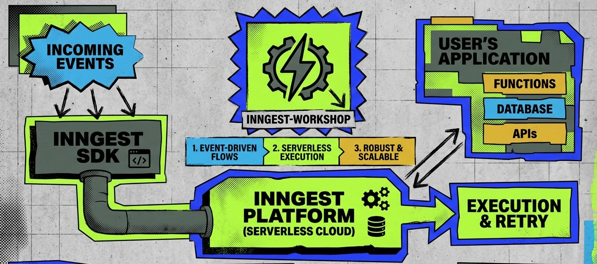

# Learn Inngest with Event-Driven Architecture

Welcome to the FastFood Workshop! This hands-on workshop teaches event-driven architecture using Inngest through a simulated fast-food kitchen order system.



## 🎯 Workshop Goals

- Understand event-driven architecture concepts
- Learn to build workflows with Inngest
- Implement real-world patterns like queuing, batching, and caching
- Minimize waste through smart inventory management

## 🚀 Quick Start

### Prerequisites

- Node.js 18.17+ installed
- npm or yarn package manager
- Git
- Code editor (VS Code recommended)

### Setup (5 minutes)

1. Clone the repository:

   ```bash
   git clone https://github.com/[org]/fastfood-workshop.git
   cd fastfood-workshop
   ```

2. Install dependencies and set up the database:

   ```bash
   npm run setup
   ```

3. Start the development servers:

   ```bash
   npm run dev
   ```

   This starts:
   - Next.js app at <http://localhost:3000>
   - Inngest Dev Server at <http://localhost:8288>
   - Drizzle Studio at <https://local.drizzle.studio>

   **Note:** The Inngest Dev Server UI is accessible at <http://localhost:8288> where you can:
   - View and test your event functions
   - Monitor event flows in real-time
   - Manually trigger events for testing

4. Open the kitchen dashboard:
   - Navigate to <http://localhost:3000/kitchen>
   - You should see the kitchen management interface
   - The dashboard includes 3 event trigger buttons for testing orders:
     - **Order Burger** 🍔 - Single burger order
     - **Burger + Fries** 🍔🍟 - Combo order
     - **Full Meal** 🍔🍟🥤 - Complete meal with drink

## 📚 Workshop Structure

1. **Introduction**
   - Inngest concepts
   - Kitchen manual simulation walkthrough

2. **Hands-on Exercises (90 min)**
   You'll implement three core Inngest functions (exercise instructions are written as code comments in the files listed):
   - Exercise 1: **prepare-food.ts** - Implement food preparation with realistic cooking times
   - Exercise 2: **warmer-management.ts** - Handle adding/removing items from the food warmer
   - Exercise 3: **fulfill-order.ts** - Complete orders when all items are ready

   **Note**: Inngest functions use direct database access via `import { db } from '@/db'` - no API calls needed! This is a best practice for internal event-driven systems.

## 🏗️ Project Structure

```text
inngest-workshop/
├── app/                                                 # Next.js app directory
│   ├── api/                                             # API routes
│   │   ├── orders/                                      # Order management endpoints
│   │   ├── foodwarmer/                                  # Food warmer inventory endpoints
│   │   ├── preparations/                                # Active preparation endpoints
│   │   ├── waste/                                       # Waste tracking endpoints
│   │   ├── events/                                      # Event triggers for Inngest workflows
│   │   ├── inngest/                                     # Inngest webhook endpoint
│   │   └── dev/                                         # Development utilities (database reset)
│   └── kitchen/                                         # Dashboard UI with event trigger buttons
├── db/                                                  # Database schema and connection
├── inngest/                                             # Event-driven functions (your workshop code!)
│   ├── client.ts                                        # Inngest client setup
│   └── functions/                                       # Implement these for the workshop
│       ├── index.ts                                     # Function exports
│       ├── process-order.ts                             # Order processing (provided)
│       ├── prepare-food.ts                              # Exercise 1: Food preparation
│       ├── warmer-management.ts                         # Exercise 2: Warmer inventory
│       └── fulfill-order.ts                             # Exercise 3: Order fulfillment + warmer matching
├── lib/                                                 # Utilities and constants
│   ├── constants.ts                                     # Food configuration
│   ├── hooks/                                           # Custom React hooks
│   └── utils.ts                                         # Utility functions
├── components/                                          # React UI components
│   └── ui/                                              # shadcn/ui components
├── e2e/                                                 # Playwright end-to-end tests
│   ├── exercise1-prepare-food.spec.ts                   # Exercise 1 tests
│   ├── exercise2-warmer-management.spec.ts              # Exercise 2 tests
│   └── exercise3-fulfill-order.spec.ts                  # Exercise 3 tests
└── public/                                              # Static assets
```

## 🍔 The Kitchen System

### Food Types

- **🍔 Burgers**: 5 sec prep, makes a batch of 5 burgers, 10 sec shelf life
- **🍟 Fries**: 2 sec prep, makes a batch of 8 fries, 8 sec shelf life
- **🥤 Sodas**: Instant (0 sec prep), gets added to the order immediately

### Core Concepts

1. **Order Processing**: When an order comes in, the system checks the food warmer for available items. If items are available, they're allocated to the order. Missing items trigger food preparation.
2. **Food Preparation**: Tracks active preparations going on in the kitchen. Each food type has specific prep times and batch sizes.
3. **Food Warmer**: Acts as a cache for prepared food with real-time expiration tracking. Items are allocated on a first-in-first-out (FIFO) basis.
4. **Expiration & Waste**: Food items have a shelf life and automatically expire. The system tracks waste from expired items.

## 🏗️ Event-Driven Architecture

### Table Responsibilities (One Table Per Function)

Each Inngest function is responsible for managing specific database tables:

- **process-order** → `orders`, `orderItems` (creation and orchestration)
- **prepare-food** → `activePreparations` (food being cooked)
- **warmer-management** → `foodWarmer`, `wasteLog` (inventory and waste tracking)
- **fulfill-order** → `orderItems.placedOnTray`, `orders.status` (completion tracking)
- **match-warmer-to-orders** → No tables (reads `orderItems` + `foodWarmer` to orchestrate)

**Note**: The `fulfill-order.ts` file contains both `fulfillOrder` and `matchWarmerToOrders` functions.

### Event Flow

```text
order.created
  ↓
process-order
  - Creates order in orders/orderItems tables
  - Checks warmer inventory
  - IF items available: sends warmer.item.remove events (with warmerIds)
  - IF items missing: sends food.prepare event

food.prepare
  ↓
prepare-food
  - Inserts into activePreparations table
  - Sleeps for cooking time (step.sleep)
  - Sends warmer.item.add events (one per item in batch)
  - Deletes from activePreparations

warmer.item.add
  ↓
warmer-management
  - ALWAYS adds to foodWarmer table
  - Sends warmer.inventory.changed event
  - Sleeps until expiration
  - Removes expired items, updates wasteLog
  - Sends food.expired event (if item actually expired)

warmer.inventory.changed (DEBOUNCED 1s per food type)
  ↓
match-warmer-to-orders
  - Queries pending orders from orderItems
  - Queries available inventory from foodWarmer
  - Matches inventory to orders (FIFO)
  - Sends warmer.item.remove events for matched items

warmer.item.remove
  ↓
warmer-management
  - Removes from foodWarmer table
  - Sends order.item.placed event

order.item.placed
  ↓
fulfill-order
  - Updates orderItems.placedOnTray (atomic increment)
  - Checks if all items for this order are complete
  - Updates orders.status to 'ready' when complete
```

### Key Architectural Principles

1. **Single Responsibility**: Each function owns specific tables and only writes to those tables
2. **Event-Driven Communication**: Functions communicate through typed events, not direct function calls
3. **Orchestration Pattern**: Orchestrator functions (like `process-order`, `match-warmer-to-orders`) can READ multiple tables but only WRITE to their own
4. **Durable Execution**: Events are sent outside `step.run()` to ensure they're only sent once
5. **Debouncing**: `match-warmer-to-orders` uses debounce to batch multiple `warmer.inventory.changed` events
6. **Race Condition Prevention**: Per-order debouncing prevents multiple items from being incorrectly allocated
7. **FIFO Allocation**: Both warmer items and order matching use first-in-first-out ordering

## 🛠️ Available Scripts

```bash
# Development
npm run setup        # Install dependencies and set up database
npm run dev          # Start all dev servers (Next.js on :3000, Inngest on :8288, Drizzle Studio on https://local.drizzle.studio)
npm run dev:next     # Start only Next.js development server (http://localhost:3000)
npm run inngest:dev  # Start only Inngest Dev Server (http://localhost:8288)

# Database
npm run db:studio    # Open Drizzle Studio (https://local.drizzle.studio/)
npm run db:push      # Apply database schema changes
npm run db:generate  # Generate database migration files

# Testing
npm run test         # Run Playwright tests
npm run test:ui      # Run Playwright tests with UI
npm run test:debug   # Run Playwright tests in debug mode
npm run test:exercise1  # Test Exercise 1: Food Preparation
npm run test:exercise2  # Test Exercise 2: Warmer Management
npm run test:exercise3  # Test Exercise 3: Order Fulfillment

# Code Quality
npm run lint         # Run linter

# Production
npm run build        # Build for production
npm run start        # Start production server
```

### Database Management

To inspect and modify your database:

```bash
npm run db:studio
```

This opens Drizzle Studio at <https://local.drizzle.studio> where you can:

- View all tables and data
- Insert test orders manually
- Clear tables between workshop exercises
- Monitor real-time database changes

## 🏛️ API Architecture

In this workshop, you'll work with two different data access patterns:

1. **Frontend → API → Database**: The kitchen dashboard uses REST APIs to fetch and display data
2. **Inngest → Database**: Event functions access the database directly for maximum performance

This architecture demonstrates a common pattern in modern applications where:

- External clients (frontend, mobile apps) use APIs for data access
- Internal services (background jobs, event handlers) use direct database connections
- APIs provide a controlled interface with validation, rate limiting, and authentication
- Direct database access eliminates network overhead for internal operations

The APIs below are primarily used by the frontend dashboard and for development/testing purposes.

## 📖 API Reference (Frontend & Testing)

### Orders

- `GET /api/orders` - List all orders
- `POST /api/orders` - Create new order
- `GET /api/orders/:id` - Get order details
- `PUT /api/orders/:id/status` - Update order status
- `PUT /api/orders/:id/items/:itemId/place` - Mark order item as placed

### Food Warmer

- `GET /api/foodwarmer` - Get current inventory
- `POST /api/foodwarmer` - Add prepared items
- `DELETE /api/foodwarmer?foodType={type}&quantity={num}` - Remove items by food type (FIFO)
- `DELETE /api/foodwarmer/:id` - Remove specific item
- `POST /api/foodwarmer/:id` - Bulk delete all expired items (requires `{ removeAllExpired: true }`)

### Food Preparations

- `GET /api/preparations` - List active preparations
- `POST /api/preparations` - Start new preparation
- `DELETE /api/preparations/:id` - Cancel preparation

### Waste Tracking

- `GET /api/waste` - Get waste statistics
- `POST /api/waste` - Log wasted items

### Events

- `POST /api/events/order` - Manually trigger order event

### Development

- `POST /api/dev/reset` - Reset database to initial state
- `GET /api/dev/reset` - Get reset statistics

### Check Function Execution

1. Open Inngest Dev Server: <http://localhost:8288>
2. Click on "Events" to see incoming events
3. Click on "Functions" to see your function runs
4. Use "Test" to manually trigger events

### Development URLs

When running `npm run dev`, the following services are available:

| Service | URL | Purpose |
|---------|-----|----------|
| Next.js App | <http://localhost:3000> | Main application and API |
| Kitchen Dashboard | <http://localhost:3000/kitchen> | Order management UI |
| Inngest Dev Server | <http://localhost:8288> | Event debugging and function testing |
| Drizzle Studio | <https://local.drizzle.studio> | Database management UI |
